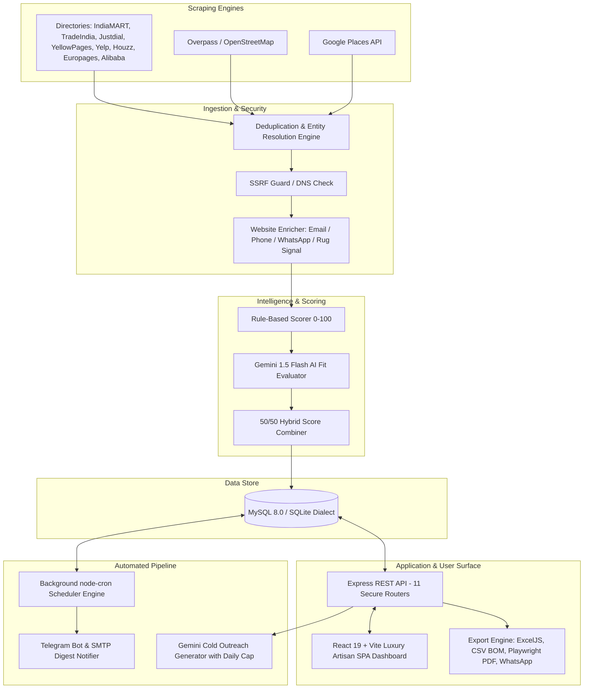

# 🏰 Knotiq Rugs — B2B Lead Scraper & Intelligence Platform

> **Production-ready, full-stack B2B lead generation, enrichment, scoring, and outreach automation platform tailored for high-end handmade rug exports.**

---

## 1. Business Context

**Knotiq Rugs** is a premium handmade rug manufacturer based in India, specializing in artisan hand-knotted, hand-tufted, flatweave, and bespoke custom rugs. 

This platform autonomously discovers, qualifies, scores, and organizes high-value B2B trade buyers across major export markets:
- 🇦🇪 **United Arab Emirates & GCC** (Dubai, Abu Dhabi, Doha, Riyadh)
- 🇺🇸 **United States** (New York, Los Angeles, Miami, Chicago, Dallas)
- 🇬🇧 **United Kingdom** (London, Manchester, Birmingham)
- 🇪🇺 **Europe** (Frankfurt, Paris, Milan, Amsterdam, Zurich)
- 🇦🇺 **Australia** (Sydney, Melbourne, Brisbane)

### Target B2B Buyer Categories
1. **Carpet & Rug Retailers** (luxury showrooms, flooring boutiques, importers, wholesalers)
2. **Interior Designers & Decorators** (high-end residential & commercial studios)
3. **Interior Fit-Out Contractors** (hospitality, turnkey corporate & luxury villa specialists)
4. **Architectural Firms** (architecture studios with dedicated interiors/FF&E practices)
5. **Hospitality & Hotel Procurement** (luxury resorts, boutique hotels, FF&E purchasers)

---

## 2. Platform Architecture



---

## 3. Key Capabilities & Features

### 🔍 Multi-Engine Scraping
- **Tier 1 High-Fidelity Sources:** Google Places API and Overpass (OpenStreetMap) with multi-mirror failover.
- **Tier 2 Directory Scrapers:** 9 modular scrapers for major trade directories (IndiaMART, TradeIndia, Justdial, Yellow Pages UAE, Yelp, Yellow Pages US, Houzz, Europages, Alibaba).
- **Stealth Browsing:** Built on Playwright and Puppeteer Stealth plugin with user-agent rotation, polite randomized delays, and `robots.txt` compliance cache.

### 🌐 Deep Website Enrichment & SSRF Defense
- Crawls up to 3 pages per business domain (Home, Contact, About) to extract emails, WhatsApp numbers, social profiles (Instagram, LinkedIn, Facebook), and rug-specific trade signals.
- Hardened with **SSRF Guard**: pre-resolves DNS and strictly blocks loopback (`127.0.0.0/8`), private networks (`10/8`, `172.16/12`, `192.168/16`), cloud instance metadata (`169.254.169.254`), and non-HTTP protocols.

### 🎯 Explainable 0–100 Scoring & Gemini AI Evaluation
- **Transparent Rule Scoring:** Evaluates category match (+20), rug signal (+15), contact reachability (+25), established reputation (+10), priority export market (+10), and B2B trade terms (+10).
- **Gemini 1.5 Flash AI Refinement:** Delimited prompt injection defense (`<untrusted_scraped_data>`), Zod schema validation, daily quota tracking (`GEMINI_DAILY_LIMIT`), and domain caching.
- **50/50 Hybrid Score:** `round(ruleScore * 0.5 + aiFitScore * 0.5)` with rich human-readable `scoreReason`.

### 📊 Multi-Format Secure Exports
- **Excel (.xlsx):** Multi-sheet workbook via `exceljs` featuring frozen header rows, auto-filters, conditional color styling (Green $\ge 70$, Amber $40-69$, Red $<40$), and executive KPI summary tab.
- **CSV (.csv):** Formula injection protection (auto-prepends `'` to active characters `=, +, -, @, \t, \r`) and UTF-8 BOM (`\uFEFF`) for flawless rendering in Microsoft Excel.
- **Executive PDF (.pdf):** High-resolution A4 dossier rendered via Playwright with KPI banner cards, table layout, and HTML fallback.
- **WhatsApp Broadcast (.txt):** E.164 phone normalization generating direct `wa.me/<number>?text=...` conversation links.
- **Signed Download Links:** HMAC-SHA256 download tokens expiring strictly after 15 minutes with canonical path traversal defense.

### 🖥️ Luxury Artisan React Dashboard
- Built with **React 19 + Vite** and Vanilla CSS design tokens (Artisan obsidian `#090D16`, deep navy `#121A2D`, and warm gold `#F59E0B`).
- **Overview:** 4 KPI cards, country & category progress distribution, and scraper run audit feed.
- **Search & Scrape:** Interactive cascading selector (Country $\to$ City $\to$ Category $\to$ Engine) with live scraping progress and "Save Preset".
- **Leads CRM:** Paginated leads table with bulk actions and slide-over detail drawer offering 1-click WhatsApp messaging, AI cold email generation, and notes editing.
- **Presets & Schedules:** Manage saved search queries and recurring cron scraper jobs.
- **Sources & Diagnostics:** Toggle individual scrapers on/off, monitor Gemini API limits, and manage the OptOut suppression list.

### ⏰ Scheduler, Notifications & Outreach Helper
- **Automated Cron Runner:** `node-cron` background engine synchronized with database schedules and run mutex locks.
- **Dual Notifications:** Real-time Telegram Bot Markdown alerts + Nodemailer SMTP digest emails.
- **Anti-Spam Outreach Engine:** Daily send cap (30/day per user), pre-send suppression checks against `OptOut`, and Gemini cold copy generation.

---

## 4. Quickstart Guide

### Option A: Local Development (SQLite)

1. **Clone & Install Dependencies:**
   ```bash
   git clone https://github.com/knotiq-rugs/lead-scraper-bot.git
   cd lead-scraper-bot
   npm install
   npm --prefix dashboard install
   ```

2. **Configure Environment:**
   ```bash
   cp .env.example .env
   # Set DB_DIALECT=sqlite (default in dev) and add API keys if available
   ```

3. **Initialize Database & Seed Data:**
   ```bash
   npm run migrate
   npm run seed
   ```

4. **Build Frontend & Start Server:**
   ```bash
   npm run build
   npm start
   ```
   Open [http://localhost:5000](http://localhost:5000) in your browser.

---

### Option B: Production (Docker Compose + MySQL 8)

1. **Configure Production `.env`:**
   ```bash
   cp .env.example .env
   # Set DB_DIALECT=mysql and production credentials
   ```

2. **Launch Stack:**
   ```bash
   docker compose up -d --build
   ```

3. **Run Migrations & Seeds in Container:**
   ```bash
   docker compose exec app npm run migrate
   docker compose exec app npm run seed
   ```

4. **Verify Health:**
   ```bash
   curl http://localhost:5000/health
   ```

---

## 5. CLI Commands

| Command | Description |
| :--- | :--- |
| `npm start` | Starts Express API and serves built dashboard on port 5000 |
| `npm test` | Runs complete 82-test automated test suite across all 7 phases via Vitest |
| `npm run build` | Compiles React 19 + Vite dashboard into `dashboard/dist` |
| `npm run migrate` | Executes idempotent database migrations tracking `SequelizeMeta` |
| `npm run seed` | Seeds 65 international locations and 19 multilingual trade keyword sets |
| `npm run scrape` | Headless CLI scraper tool (`--country UAE --city Dubai --type rug_retailer`) |
| `npm run check:scrapers` | Self-test runner executing live connectivity tests across all scrapers |
| `npm run backup` | Creates timestamped SQLite file backups and portable JSON table snapshots |

---

## 6. REST API Endpoints

All endpoints (except public `/health` and signed download URLs) require Clerk JWT authentication or `ENABLE_TEST_AUTH=true` with `x-test-user-id`.

| Router | Method | Path | Description |
| :--- | :--- | :--- | :--- |
| **System** | `GET` | `/health` | Uptime, memory usage, and database connection status |
| **Leads** | `GET` | `/api/leads` | Paginated search, filter by country/city/leadType/score |
| | `GET` | `/api/leads/:id` | Lead details with score explanation & contact points |
| | `PATCH` | `/api/leads/:id` | Update status (`new`, `contacted`, `converted`, `rejected`) or notes |
| | `POST` | `/api/leads/bulk-status` | Bulk update lead statuses |
| **Scrape** | `POST` | `/api/scrape/run` | Execute scraping job across selected engine and location |
| | `GET` | `/api/scrape/runs` | List past scraping run logs with duration & metrics |
| **Presets** | `GET` | `/api/presets` | List saved search query presets |
| | `POST` | `/api/presets` | Create new search query preset |
| **Schedules** | `GET` | `/api/schedules` | List recurring cron scraper schedules |
| | `POST` | `/api/schedules/:id/run-now` | Immediately trigger scheduled scraper run |
| **Exports** | `POST` | `/api/exports` | Trigger async export job (`xlsx`, `csv`, `pdf`, `whatsapp`) |
| | `GET` | `/api/exports/download/:token` | 15-minute HMAC-signed file download endpoint |
| **Outreach** | `GET` | `/api/outreach/stats` | Daily outreach count and quota tracker |
| | `POST` | `/api/outreach/draft` | Generate AI cold email or template draft |
| | `POST` | `/api/outreach/record-sent` | Increment daily send counter & mark lead contacted |
| **OptOut** | `POST` | `/api/optout` | Add email, domain, or phone to suppression blacklist |
| **Settings** | `GET` | `/api/settings` | System diagnostics, Gemini API limit, and DB dialect |

---

## 7. Security & Compliance Summary

Detailed architectural documentation is available in [SECURITY.md](file:///f:/lead-scraper-bot/SECURITY.md) and [DECISIONS.md](file:///f:/lead-scraper-bot/DECISIONS.md).

- **SSRF Immunity:** Pre-resolves DNS and blocks access to cloud metadata (`169.254.169.254`), private networks, and non-HTTP protocols.
- **Formula Injection Defense:** Prepends `'` to active spreadsheet formula characters in CSV exports.
- **Prompt Injection Defense:** Wraps untrusted text in `<untrusted_scraped_data>` delimiters and enforces strict Zod schema validation.
- **Signed Download Links:** HMAC-SHA256 download tokens expiring after 15 minutes with canonical path traversal guards.
- **Polite Crawling:** Respects `robots.txt`, implements exponential backoff, rate limits concurrent workers, and honors suppression lists.

---

## 8. License & Proprietary Notice

Proprietary and Confidential. Copyright © 2026 **Knotiq Rugs**. All rights reserved.
