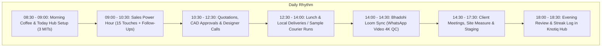

# KNOTIQ RUGS — B2B GROWTH ENGINE MINDMAP & STRATEGIC BLUEPRINT

> **Business Context:**
> - **Company:** Knotiq Rugs (Handmade & Custom Rug Manufacturer / Exporter)
> - **UAE Office & Sales Hub:** Ajman, UAE (Lead generation, client relations, designer consultations, local delivery & installation)
> - **Manufacturing Facility:** Bhadohi (Sant Ravidas Nagar), Uttar Pradesh, India (Master tufting looms, dyeing, latexing, hand-carving, and QC)
> - **Target ICPs:** UAE & GCC Interior Designers (Residential & Commercial), Hospitality & Hotel Procurement, High-End Furniture Retailers, Property Developers, Fitout Contractors
> - **Core Competitive Moat:** Direct-from-Loom pricing + 21-Day Turnaround vs. European/Turkish traders (8–12 weeks) + Physical 6-Tuft Luxury Architect Swatch Box + 100% DDP UAE Delivery

---

## PART A: INTERACTIVE ACCESS
1. **In-Dashboard Strategy Hub:** Navigate to `Growth & Outreach` ➔ `Growth Mindmap` (`/mindmap`) in your Knotiq Command Center.
   - Includes real-time search, branch filtering, collapsible branches, and persistent checkbox progress tracking (saved locally in your browser).
2. **Standalone Fullscreen HTML:** Open [docs/knotiq_growth_mindmap.html](file:///f:/lead-scraper-bot/docs/knotiq_growth_mindmap.html) directly in any browser for a dark-luxury, print-ready, visual node canvas.

---

## PART B: COMPLETE MINDMAP OUTLINE (10 BRANCHES, 35 ACTIONABLE NODES)

### 1. B2B Sales Pipeline & Closing Engine
*Turning cold designer inquiries into high-margin custom rug purchase orders*

#### 1.1 Lead Ingestion & Micro-Segment Tagging
- **WHY:** Cold B2B sales fail when generic pitches are sent to specialized buyers. A luxury villa designer in Jumeirah needs bespoke New Zealand wool tufted specs, whereas a commercial contractor in Downtown Dubai cares about 500+ sqm fire-rated heavy blends.
- **HOW:** Review newly scraped leads in Knotiq Command Center. Tag each lead with Buyer Type: Interior Designer (Residential/Commercial), Hotel/Hospitality, Rug Retailer/Showroom, Fitout Contractor, or Property Developer. Assign estimated project tier (Tier 1 Luxury, Tier 2 Mid-High).
- **WHEN:** Daily (09:00 - 09:30 UAE Time)
- **OWNER:** Founder
- **KPI:** 100% of newly scraped leads tagged with buyer type within 24h
- **COST/EFFORT:** 0 AED / 30 mins daily
- **DEPENDS ON:** Search & Scrape discovery running
- **PRIORITY:** P0

#### 1.2 3-Touch Cold Outreach Playbook (WhatsApp + Email)
- **WHY:** In the UAE B2B design ecosystem, email gets buried, but WhatsApp gets opened within 4 minutes. A multi-channel sequence ensures maximum reach without spamming.
- **HOW:** Day 1: WhatsApp audio/text intro with 1 high-res image of a recent custom hand-tufted rug delivered in Dubai + short value hook (21-day direct-loom turnaround vs European 10-week imports). Day 4: Project spotlight / video of artisan carving in Bhadohi. Day 7: Physical Swatch Kit offer delivered to their office.
- **WHEN:** Ongoing (Batch 15-20 leads/day)
- **OWNER:** Founder
- **KPI:** 20-25% first-reply rate across WhatsApp + Email
- **COST/EFFORT:** 0 AED / 45 mins daily
- **DEPENDS ON:** Verified phone numbers & email templates
- **PRIORITY:** P0

#### 1.3 The "Physical Swatch Box" In-Person Closer
- **WHY:** Interior designers NEVER specify a 25,000 AED rug from a digital PDF. They must feel pile density, wool softness (100% NZ Wool vs Indian blend), and check sheen (botanical silk/Tencel vs viscose). Once your physical swatch sits on their material mood board, Knotiq is on their vendor shortlist.
- **HOW:** Assemble Knotiq Luxury Sample Kits: 6 mini-swatches (Cut Pile 100% NZ Wool, Loop Pile, Wool + Botanical Silk blend, Carved High-Low, Fire-Rated Hospitality Spec, Hand-Knotted 60-knot swatch) + engraved metal Knotiq tag + QR code linking to digital spec sheets. Hand-deliver or send via Careem Box to Dubai Design District (D3) & Al Quoz design studios.
- **WHEN:** Weekly on Tuesday/Thursday afternoons
- **OWNER:** Founder (Ajman Office)
- **KPI:** 60% quote request rate from designers who receive the physical box
- **COST/EFFORT:** 45 AED per box (yarn tufts + box) + courier/fuel
- **DEPENDS ON:** Curated 12x12" tuft samples from Bhadohi
- **PRIORITY:** P0

#### 1.4 4-Hour Rapid Quotation Engine
- **WHY:** Designers work on brutal deadlines for client presentations. The rug manufacturer that returns a clean, branded PDF quote with 3D render preview in 4 hours wins the project before competitors even reply.
- **HOW:** Use standardized Knotiq Pricing Matrix: Base Loom Cost (Bhadohi) + International Air Cargo (DDP Dubai) + Local Delivery + Gross Margin (45-55%). Send professional quote with breakdown: Size, Pile Height, Yarn Specification, Delivery Date, and 50% Advance terms.
- **WHEN:** Within 4 hours of receiving CAD/render
- **OWNER:** Founder + Bhadohi Costing Lead
- **KPI:** < 4 hour turnaround time; > 35% quote-to-deposit win rate
- **COST/EFFORT:** 0 AED / 20 mins per quote
- **DEPENDS ON:** Standardized sqm cost calculator
- **PRIORITY:** P1

#### 1.5 Deposit Lock & Formal CAD Strike-Off Approval
- **WHY:** Custom manufacturing without signed strike-off approvals is financial suicide. Never buy raw yarn or warp looms without written design approval and cleared deposit.
- **HOW:** Generate digital 2D CAD artwork showing exact Pantone / ARS yarn color codes, pile direction, carving lines, and finishing borders. Require client digital sign-off and receipt of 50% wire transfer to Knotiq Ajman account before Bhadohi looms start spinning.
- **WHEN:** Within 48 hours of quote acceptance
- **OWNER:** Founder + Bhadohi CAD Artist
- **KPI:** 100% signed production approvals before loom warping begins
- **COST/EFFORT:** 0 AED
- **DEPENDS ON:** Client 50% bank transfer received in UAE bank
- **PRIORITY:** P0

---

### 2. Lead Generation & Target Scraping
*Building a verified database of 1,000+ UAE & GCC luxury rug specifiers*

#### 2.1 Google Maps Scraping: D3, Al Quoz, Downtown, Business Bay
- **WHY:** The concentration of high-net-worth villa and commercial interior designers in Dubai is geographically concentrated in Dubai Design District (D3), Al Quoz industrial creative zones, Business Bay, and Jumeirah.
- **HOW:** Configure SearchScrape presets with targeted keywords: "interior design consultant Dubai", "luxury villa interior designer Jumeirah", "hospitality fitout contractor Dubai", "penthouse interior architect UAE". Run extraction, verify trade license address, export clean dataset.
- **WHEN:** Weekly automated runs (Sundays)
- **OWNER:** Founder (Scraper Bot)
- **KPI:** 50-75 fresh, deduplicated leads enriched weekly
- **COST/EFFORT:** 0 AED (Local scraper engine)
- **DEPENDS ON:** Knotiq Lead Scraper Bot presets
- **PRIORITY:** P0

#### 2.2 LinkedIn Sales Navigator Extraction & Direct Decision-Maker Hunting
- **WHY:** Reaching generic "info@" emails yields low conversion. Reaching the "Senior FF&E Designer" (Furniture, Fixtures & Equipment) or "Principal Architect" puts you directly in front of the person choosing rug vendors.
- **HOW:** Filter for UAE-based professionals with job titles: "FF&E Designer", "Interior Architect", "Managing Director Interior Design", "Procurement Manager Hospitality". Cross-reference company websites to capture direct WhatsApp / mobile numbers where public.
- **WHEN:** Twice weekly (Wednesdays & Saturdays)
- **OWNER:** Founder
- **KPI:** 25 verified Principal Designers / Head of FF&E added per week
- **COST/EFFORT:** LinkedIn Sales Nav subscription / 2 hrs weekly
- **DEPENDS ON:** Sales Navigator filter setup
- **PRIORITY:** P1

#### 2.3 Directory Mining: Index Dubai, CID, Downtown Design
- **WHY:** Firms paying 50,000+ AED to exhibit or attend Index Dubai and Downtown Design have active, funded projects and demanding high-budget clients.
- **HOW:** Scrape and curate exhibitor lists, speaker panels, and award shortlists from Commercial Interior Design (CID) Awards and Index Dubai. Ingest into Knotiq Command Center tagged with "High-Value Target".
- **WHEN:** Monthly sprint
- **OWNER:** Founder
- **KPI:** Complete directory of 200+ exhibiting design firms and award nominees
- **COST/EFFORT:** 0 AED
- **DEPENDS ON:** Exhibitor list web scraping
- **PRIORITY:** P1

#### 2.4 Phone & WhatsApp Verification Filter
- **WHY:** Sending cold WhatsApp messages to landlines or inactive numbers burns time and risks account flagging.
- **HOW:** Filter scraped phone numbers in Knotiq Bot. Strip invalid country codes, ensure +971 format, filter out landlines (+971 4 xxx xxxx vs +971 5x xxx xxxx). Only queue mobile numbers for WhatsApp outreach.
- **WHEN:** Pre-outreach gate
- **OWNER:** Founder
- **KPI:** > 95% deliverability; 0 WhatsApp account flags
- **COST/EFFORT:** 0 AED
- **DEPENDS ON:** Lead import
- **PRIORITY:** P0

---

### 3. Multi-Channel Cold Outreach & Scripts
*High-touch, respectful B2B relationship building that opens designer doors*

#### 3.1 Designer-First Value Proposition Hook
- **WHY:** Designers hate generic wholesaler catalogs. They love 3 things: 1) Custom sizes with no shape restrictions; 2) Exact color matching to their fabric boards; 3) Fast 21-day direct-loom delivery without middlemen markup.
- **HOW:** Draft Variant A & B in Knotiq Templates: *"Hi [Name], loved your recent [Project Name/Style] project. We manufacture custom hand-tufted rugs directly on our looms in Bhadohi for Dubai designers—delivering bespoke NZ wool & silk rugs in 21 days with full DDP delivery to your site. Would love to send a complimentary 6-piece swatch kit to your studio."*
- **WHEN:** Immediate template standardization
- **OWNER:** Founder
- **KPI:** Zero "catalog spam" sent; personalized hook in every message
- **COST/EFFORT:** 0 AED
- **DEPENDS ON:** TemplatesTab in Marketing Hub
- **PRIORITY:** P0

#### 3.2 WhatsApp Visual Social Proof (4-Second Loom Video)
- **WHY:** In a world of drop-shippers, showing a genuine master weaver hand-shearing a custom rug with Bhadohi loom sounds proves you are the actual factory.
- **HOW:** Record high-res 4K, 5-second vertical clips: artisan hand-tufting with pneumatic gun, organic botanical yarn dyeing, hand-carving high-low pile. Attach as lightweight media on Day 4 follow-up.
- **WHEN:** Captured weekly from Bhadohi factory
- **OWNER:** Founder + Bhadohi Team
- **KPI:** 3x higher reply rate compared to plain text messages
- **COST/EFFORT:** 0 AED
- **DEPENDS ON:** Factory footage shared via WhatsApp
- **PRIORITY:** P0

#### 3.3 Strict Pacing & WhatsApp Ban Prevention
- **WHY:** Automated blast spamming gets WhatsApp numbers banned within 48 hours. Human-paced, conversational outreach builds 50,000 AED client relationships.
- **HOW:** Limit outbound touches to 15-20 new leads per day. Pacing intervals: 90-180 seconds between messages. Use WhatsApp Business with verified profile, Knotiq Ajman office location, and catalog links.
- **WHEN:** Built into Daily Sales Power Hour
- **OWNER:** Founder
- **KPI:** 0 account suspensions; consistent 15-20 personalized touches daily
- **COST/EFFORT:** 0 AED
- **DEPENDS ON:** Knotiq Daily Cap Settings
- **PRIORITY:** P0

#### 3.4 The "Revive Stalled Quote" Day 14 Follow-up
- **WHY:** Designers frequently get stalled by client budget approvals. A supportive, problem-solving check-in closes deals that would otherwise slip away.
- **HOW:** Send personalized message: *"Hi [Name], following up on the 3.5m x 2.8m wool-silk quote for the Palm Jumeirah villa. If the client is optimizing budget, we can adjust the botanical silk ratio to 30% or optimize pile density to maintain the exact look while saving 18% on total cost. Let me know if that helps your presentation!"*
- **WHEN:** Every Monday morning review
- **OWNER:** Founder
- **KPI:** 15-20% revival rate on pending quotations
- **COST/EFFORT:** 0 AED
- **DEPENDS ON:** Leads Pipeline quote stage tracking
- **PRIORITY:** P1

---

### 4. Inbound Brand & Content Strategy
*Establishing Knotiq as the definitive artisan rug manufacturer in the GCC*

#### 4.1 Instagram & LinkedIn Proof Engine (3x/Week Rhythm)
- **WHY:** UAE interior designers vet vendors on Instagram before replying to your WhatsApp message. If your feed looks amateur, you lose the deal before the conversation starts.
- **HOW:** Post 3 distinct pillars: 1) Reel: Bhadohi craftsmanship & yarn carving close-ups; 2) Carousel: Before/After 3D render vs delivered rug in a Dubai penthouse; 3) Technical Post: NZ Wool vs Viscose durability guide for GCC climates.
- **WHEN:** Mon, Wed, Fri (Scheduled in Knotiq Content Calendar)
- **OWNER:** Founder
- **KPI:** 12 high-authority project/manufacturing posts published monthly
- **COST/EFFORT:** 0 AED / 1 hr weekly planning
- **DEPENDS ON:** Knotiq Content Calendar (Phase C)
- **PRIORITY:** P1

#### 4.2 Project Case Studies & Designer Features
- **WHY:** Interior designers love publicity. By tagging their studio and praising their design vision, they re-share your post to their thousands of design followers.
- **HOW:** Request permission to photograph installed rug in finished space. Write case study: *"Custom 4x3m Organic Curved Rug for Luxury Villa in Emirates Hills — Designed by [Studio], Handcrafted by Knotiq Rugs"*.
- **WHEN:** Monthly upon project completion
- **OWNER:** Founder + Designer Clients
- **KPI:** 1 featured designer partnership case study published per month
- **COST/EFFORT:** Photographer tip / high-res phone captures
- **DEPENDS ON:** Completed and delivered custom rug orders
- **PRIORITY:** P1

#### 4.3 Digital Spec Sheets & Technical FF&E Pack
- **WHY:** Commercial and hospitality projects require Fire Retardant (FR) certifications (CRI Green Label Plus, IMO fire rating, heavy traffic durability tests).
- **HOW:** Assemble a 4-page Knotiq Spec Guide: Pile types, wool microns, yarn densities, backing latex specifications, fire compliance certifications, and maintenance guidelines.
- **WHEN:** Week 2 setup
- **OWNER:** Founder
- **KPI:** Downloadable PDF ready for any designer procurement team
- **COST/EFFORT:** 0 AED (Canva / PDF spec)
- **DEPENDS ON:** Yarn specifications and lab test certificates
- **PRIORITY:** P1

---

### 5. Google Search & Local Presence
*Capturing high-intent B2B search traffic for custom rugs across UAE*

#### 5.1 Google Business Profile Optimization (Ajman Office & Warehouse)
- **WHY:** Procurement heads and expats search "custom rugs Dubai" or "handmade carpet supplier UAE" on Google when they have immediate budget and an active deadline.
- **HOW:** Claim & optimize GBP: Primary category "Rug Store" + secondary "Carpet Manufacturer". Add exact keywords in description: custom hand tufted rugs, bespoke handmade carpets, hospitality carpet supplier. Post 5 new photos weekly of completed rugs and loom craftsmanship.
- **WHEN:** Week 1 setup + weekly photo update
- **OWNER:** Founder
- **KPI:** Top 3 Map Pack ranking for "custom rug manufacturer UAE / Ajman / Dubai"
- **COST/EFFORT:** 0 AED
- **DEPENDS ON:** Verified Google Business Profile
- **PRIORITY:** P0

#### 5.2 High-Intent B2B SEO Landing Pages
- **WHY:** A single high-ranking page for "hospitality carpet supplier UAE" can generate 200,000+ AED in annual hotel refurbishment contracts without ad spend.
- **HOW:** Create targeted pillar pages: `/custom-rugs-dubai`, `/hospitality-carpets-uae`, `/hand-tufted-rug-manufacturer-india`, `/interior-designer-rug-program`. Include FAQs, technical specs, and instant WhatsApp inquiry button.
- **WHEN:** Month 2 build
- **OWNER:** Founder
- **KPI:** Page 1 organic rankings for high-intent GCC commercial rug keywords
- **COST/EFFORT:** 0 AED / 3 hrs per page
- **DEPENDS ON:** Website setup
- **PRIORITY:** P2

#### 5.3 Review Generation Flywheel (5-Star Verified Client Reviews)
- **WHY:** Nothing builds trust faster for a high-ticket transaction than detailed reviews from other Dubai interior designers praising punctuality, pile softness, and loom direct pricing.
- **HOW:** Send personalized WhatsApp review link: *"Hi [Name], so thrilled to see the villa rug installed! Would mean the world to our Bhadohi artisan team if you could drop a quick 2-line review on Google. Here is direct link [Google Review Link]."*
- **WHEN:** Within 48 hours of successful rug delivery
- **OWNER:** Founder
- **KPI:** 15+ detailed 5-star Google reviews with photos within 90 days
- **COST/EFFORT:** 0 AED
- **DEPENDS ON:** Client delivery sign-off
- **PRIORITY:** P1

---

### 6. Physical Swatch Kit & Sampling Engine
*The tangible sales asset that converts cold inquiries into locked contracts*

#### 6.1 Standardized 6-Tuft Luxury Architect Kit
- **WHY:** In B2B textiles, touch is everything. If a designer has your physical samples in their studio library, they grab your yarn when making client mood boards.
- **HOW:** Kit contents: 1) 100% New Zealand Wool 4500g cut pile; 2) Hand-spun New Zealand Wool with high-low loop; 3) 50% Wool / 50% Botanical Bamboo Silk; 4) 100% Pure Botanical Silk luxury sheen; 5) Multi-level hand-carved sample; 6) Commercial contract-grade heavy loop. Packaged in matte black branded Knotiq box with gold foil lettering.
- **WHEN:** Keep 10 kits pre-assembled in Ajman inventory
- **OWNER:** Founder (Assembly) + Bhadohi (Weaving)
- **KPI:** Deliver 5 kits weekly to qualified Tier 1 design studios
- **COST/EFFORT:** 40-50 AED per kit manufacturing cost
- **DEPENDS ON:** Inventory of sample tufts shipped from Bhadohi
- **PRIORITY:** P0

#### 6.2 Rapid 72-Hour Custom Color Pom Delivery
- **WHY:** Color mismatch is the #1 reason custom rugs get rejected. If the client specified warm taupe and received grey beige, you absorb a 20,000 AED loss.
- **HOW:** Maintain full set of standardized wool color poms in the Ajman office. When a designer shares a Benjamin Moore or RAL paint swatch, match exact yarn pom and hand-courier it to their studio for physical approval.
- **WHEN:** Within 48-72h of designer palette request
- **OWNER:** Founder (Ajman Office Stock)
- **KPI:** 100% color approval match before loom setup
- **COST/EFFORT:** Stock ARS / Pantone yarn pom box in Ajman
- **DEPENDS ON:** ARS 600 or Chromatics color pom box held in UAE
- **PRIORITY:** P1

#### 6.3 Sample Recovery & Follow-Up Protocol
- **WHY:** Sending a box and going silent wastes 50 AED. Following up when the box arrives transforms a free gift into an active project RFQ (Request for Quote).
- **HOW:** Track delivery via courier. When delivered: *"Hi [Name], reception confirmed the Knotiq Swatch Box arrived at your D3 studio today. Hope you love the New Zealand wool touch! Do you have any active residential or commercial projects where we can quote sizes for you this month?"*
- **WHEN:** Day 5 after sample kit delivery
- **OWNER:** Founder
- **KPI:** 100% of sample deliveries followed up within 5 business days
- **COST/EFFORT:** 0 AED
- **DEPENDS ON:** Sample delivery logged in Knotiq CRM
- **PRIORITY:** P1

---

### 7. Bhadohi Manufacturing & QC Bridge
*Direct-from-loom advantage: 21-day production, master quality control*

#### 7.1 Daily 14:00 UAE / 15:30 IST Production Sync
- **WHY:** As a solo founder in UAE with manufacturing in India, production slip-ups kill client trust. A strict 20-minute daily operational sync ensures problems are caught before yarn is cut.
- **HOW:** Review active production board: 1) Yarn dyeing & lab dips; 2) Loom warping & tufting progress; 3) Latexing & secondary backing; 4) Hand carving & shearing; 5) Final dispatch readiness. Check photos and videos of each active loom.
- **WHEN:** Daily (Mon - Sat) at 14:00 Dubai time
- **OWNER:** Founder + Bhadohi Loom Master
- **KPI:** Zero production surprises; 100% on-time loom milestone completion
- **COST/EFFORT:** 0 AED / 20 mins daily
- **DEPENDS ON:** Bhadohi factory WhatsApp video connection
- **PRIORITY:** P0

#### 7.2 Mandatory 5-Point 4K Video Quality Check Before Packing
- **WHY:** Discovering a size error (e.g. 290cm instead of 300cm) after international air freight to Dubai costs thousands in freight, duties, and client penalties.
- **HOW:** Bhadohi team must record and send a single continuous 4K video showing: 1) Steel tape measurement of exact length and width; 2) Backing latex adhesion & binding edges; 3) Sunlight / balanced white light color check against master approved pom; 4) Hand shear pile consistency; 5) Water droplet / stain repelling check if treated.
- **WHEN:** Before rolling and packing any rug in Bhadohi
- **OWNER:** Bhadohi QC Lead
- **KPI:** 0% defect rate upon arrival in UAE; 100% client acceptance
- **COST/EFFORT:** 0 AED
- **DEPENDS ON:** High-res phone camera & measuring tape
- **PRIORITY:** P0

#### 7.3 Raw Material Buffer Stock (NZ Wool & Botanical Silk)
- **WHY:** Waiting 10 days to source raw New Zealand wool after receiving an order destroys your 21-day delivery promise.
- **HOW:** Keep a rolling buffer of 200kg premium un-dyed New Zealand wool yarn and 100kg botanical silk yarn at the Bhadohi facility so dyeing starts within 24 hours of CAD approval.
- **WHEN:** Monthly replenishment
- **OWNER:** Bhadohi Procurement
- **KPI:** Immediate 24h loom start upon 50% client deposit
- **COST/EFFORT:** Working capital allocation for 250kg yarn buffer
- **DEPENDS ON:** Cash flow management
- **PRIORITY:** P1

---

### 8. Logistics, Shipping & Cash Flow
*Reliable air/sea freight from Varanasi to Dubai, 100% DDP seamless delivery*

#### 8.1 Air Freight Express Corridor (Varanasi / Delhi to DXB / SHJ)
- **WHY:** Air cargo is the secret to beating European rug importers who take 8 to 12 weeks. Designers happily pay premium prices for a 21-day turnkey delivery.
- **HOW:** Consolidate completed rugs in Bhadohi. Truck to Varanasi Airport (VNS) or Delhi Cargo Hub. Fly direct to Dubai (DXB) or Sharjah (SHJ). Clear customs using UAE Trade License with DDP (Delivered Duty Paid) so client receives the rug hassle-free.
- **WHEN:** 5-7 calendar days transit door-to-door
- **OWNER:** Founder + Air Cargo Partner
- **KPI:** Consistent 5-7 day door-to-door transit time
- **COST/EFFORT:** Standard air cargo tariff (~18-24 AED/kg)
- **DEPENDS ON:** Export paperwork (IEC, Commercial Invoice, Packing List)
- **PRIORITY:** P0

#### 8.2 The 50/40/10 Bulletproof Payment Term Structure
- **WHY:** Letting clients pay 100% after delivery in the UAE leads to 60-90 day payment delays, suffocating working capital.
- **HOW:** Standard Terms: 50% Advance deposit before loom setup; 40% Balance upon video QC approval from Bhadohi prior to dispatch from India; 10% on physical delivery and placement in UAE. For trusted repeat designers: 50% deposit, 50% against delivery note.
- **WHEN:** Contract agreement gate
- **OWNER:** Founder
- **KPI:** Zero outstanding receivables after final installation
- **COST/EFFORT:** 0 AED
- **DEPENDS ON:** Client contract terms
- **PRIORITY:** P0

#### 8.3 Ajman White-Glove Staging & Site Installation
- **WHY:** Dropping a rolled rug in plastic at the door is what cheap couriers do. Rolling it out, steaming pile folds, placing felt underlay, and arranging client furniture justifies a 15,000+ AED luxury price point.
- **HOW:** Inspect rug at Ajman staging facility. Vacuum and groom pile with soft brush. Coordinate delivery with designer on-site. Place non-slip anti-microbial underlay. Position rug, tuck edges, steam any packing pressure lines, and take delivery sign-off signature.
- **WHEN:** Scheduled 48h before client delivery date
- **OWNER:** Founder + Local Delivery Team
- **KPI:** 100% flawless handover with underlay fitted & furniture replaced
- **COST/EFFORT:** 150-250 AED per delivery van + 2 helpers
- **DEPENDS ON:** Custom underlay inventory in Ajman
- **PRIORITY:** P1

---

### 9. Operations, Time Mastery & Founder Rhythm
*Solo founder execution system: eliminating burnout and guaranteeing daily momentum*

#### 9.1 The 09:00 - 10:30 Sales Power Hour (Non-Negotiable)
- **WHY:** If the founder does not sell before 10:30 AM, operational fires (freight, emails, loom questions) will consume the entire day, leaving the sales pipeline dry.
- **HOW:** Phone on Do Not Disturb. Open Knotiq Command Center Today Hub. Execute 3 MITs: 1) Send Day 1 / Day 4 / Day 7 follow-ups; 2) Outreach to 15 newly scraped designers; 3) Send pending quotes from yesterday. No admin or social media allowed during this block.
- **WHEN:** Daily (Mon - Fri) 09:00 - 10:30 UAE Time
- **OWNER:** Founder
- **KPI:** 15-20 outreach touches sent; 5 follow-ups executed every morning
- **COST/EFFORT:** 0 AED / 90 minutes focused attention
- **DEPENDS ON:** Knotiq Today Command Center
- **PRIORITY:** P0

#### 9.2 The 18:30 Evening Review & Streak Maintenance
- **WHY:** Unreviewed days compound into chaotic weeks. Logging daily wins, quotes sent, and setting tomorrow's 3 MITs clears mental anxiety and creates unstoppable compounding momentum.
- **HOW:** Open Knotiq Evening Review. Check metrics: Leads contacted, Swatch kits delivered, Quotes out, Revenue booked. Log reflection note in Founder Notebook. Define top 3 Most Important Tasks (MITs) for tomorrow.
- **WHEN:** Daily at 18:30 UAE Time
- **OWNER:** Founder
- **KPI:** 100% daily streak logged in Knotiq Command Center
- **COST/EFFORT:** 0 AED / 15 minutes
- **DEPENDS ON:** Today Command Center completion
- **PRIORITY:** P0

#### 9.3 Sunday Pipeline & Strategy Audit (60 Mins)
- **WHY:** Starting Monday morning wondering "what should I do today?" costs 2 hours of prime selling time.
- **HOW:** 1) Run weekly scraper to load 100 new leads into queue; 2) Review stalled deals and schedule Monday calls; 3) Verify sample kit boxes in Ajman office; 4) Check Bhadohi dispatch schedule for the upcoming week.
- **WHEN:** Every Sunday at 17:00 UAE Time
- **OWNER:** Founder
- **KPI:** Clean CRM pipeline; next week's sample kits and scrapers prepped
- **COST/EFFORT:** 0 AED / 60 minutes
- **DEPENDS ON:** Knotiq Reports & CRM data
- **PRIORITY:** P1

---

### 10. Risk Safeguards & Quality Control
*Protecting capital, reputation, and client trust in custom manufacturing*

#### 10.1 Anti-Color Discrepancy Protocol (Physical Pom Sign-Off)
- **WHY:** Digital screens show RGB colors differently (iPhone vs Samsung vs calibrated monitor). Weaving a rug based on a WhatsApp photo screenshot guarantees a color dispute.
- **HOW:** For any custom color, either: 1) Match to standard ARS / Pantone TPG code in person; or 2) Send physical 2x2" dyed yarn pom to the designer with a sign-off sticker before loom weaving begins.
- **WHEN:** Pre-production gate on every project > 10,000 AED
- **OWNER:** Founder
- **KPI:** 0% color rejection disputes
- **COST/EFFORT:** 0 AED
- **DEPENDS ON:** Client signed strike-off document
- **PRIORITY:** P0

#### 10.2 Loom Monsoon & Weather Contingency Buffer (July - Sept)
- **WHY:** High humidity during Uttar Pradesh monsoon slows latex curing and outdoor rug drying by 4 to 6 days. Not planning for this leads to broken delivery promises.
- **HOW:** Equip Bhadohi finishing facility with closed-room industrial blowers and dehumidifiers. Add 4 calendar days buffer to customer quoted timeline during monsoon months.
- **WHEN:** Monsoon season buffer (July - September)
- **OWNER:** Bhadohi Production Lead
- **KPI:** Zero weather-related delivery delays passed to UAE clients
- **COST/EFFORT:** Dehumidifiers in Bhadohi finishing room
- **DEPENDS ON:** Electric drying and dehumidification setups in Bhadohi
- **PRIORITY:** P1

#### 10.3 Air Cargo Transit Loss & Damage Insurance
- **WHY:** Air cargo pallets can experience forklift tears or tarmac rain damage during airport transshipment.
- **HOW:** Mandate double-layer waterproof packaging: 1) Heavy polyethylene inner wrap heat-sealed; 2) High-density woven jute/poly outer bag stitched with nylon thread. Ensure All-Risk Marine/Air Cargo insurance coverage on every Air Waybill.
- **WHEN:** Every international shipment
- **OWNER:** Founder
- **KPI:** 100% financial recovery in case of water/tear transit damage
- **COST/EFFORT:** ~0.3% of declared consignment value
- **DEPENDS ON:** Cargo insurance policy with freight forwarder
- **PRIORITY:** P0

#### 10.4 Client Ghosting Mitigation: Non-Refundable Custom Deposit
- **WHY:** If a client cancels a custom 5m curved purple rug halfway through weaving, it cannot be resold to anyone else.
- **HOW:** Explicitly state in quotation and invoice: *"Custom bespoke rugs are made to individual client specifications and dimensions. The 50% advance deposit covers dedicated raw yarn procurement and artisan loom warping, and is strictly non-refundable once CAD strike-off is approved."*
- **WHEN:** Contract terms clause
- **OWNER:** Founder
- **KPI:** Zero unrecovered manufacturing costs from cancelled custom orders
- **COST/EFFORT:** 0 AED
- **DEPENDS ON:** Standard Knotiq sales quotation terms
- **PRIORITY:** P0

---

## PART C: SUPPORTING STRATEGIC DOCUMENTS

### 1. The 20% That Drives 80% (6 High-Leverage Actions)
*As a solo founder, ignore 90% of vanity tasks and execute only these 6 things:*

1. **Daily 09:00 Sales Power Hour:** Sending 15-20 personalized WhatsApp/Email touches and executing Day 1/4/7 follow-ups before touching anything else.
2. **Delivering 5 Physical Swatch Boxes Weekly:** Hand-delivering or couriering luxury sample kits to D3 and Al Quoz interior design studios.
3. **4-Hour Quotation Turnaround:** Returning CAD quote calculations within 4 hours while the designer's presentation is still in draft.
4. **Mandatory 50% Upfront Deposit:** Clearing 50% payment before a single meter of yarn is spun on Bhadohi looms.
5. **Daily 14:00 20-Minute Bhadohi Video Sync:** Checking active loom progress and reviewing 4K QC inspection videos prior to dispatch.
6. **White-Glove Site Delivery & Photo Case Study:** Placing the rug in person, securing client sign-off, taking high-res photos, and gathering a 5-star Google review.

---

### 2. 90-Day Execution Roadmap Table

| Period | Core Focus | Weekly Milestones | Key Checkpoint & Target |
| :--- | :--- | :--- | :--- |
| **Week 1** | Foundation & Pipeline Prep | Clean Google Maps scraper presets for D3 & Al Quoz; configure GBP; standardize 4-hour quote matrix. | 100 verified designer leads in CRM; 10 Swatch Kits assembled in Ajman. |
| **Week 2** | Outreach Launch | Start daily 15-touch WhatsApp sequence; deliver first 5 Swatch Boxes to D3 studios. | 75 leads contacted; 15 active conversations; 3 quote requests. |
| **Week 3** | Sample Follow-Ups & Quoting | Follow up on delivered boxes; quote first 5 bespoke residential villa rugs; refine Bhadohi CAD turnaround. | First 1-2 closed custom orders with 50% deposits collected. |
| **Week 4** | Production Calibration | First orders running on Bhadohi looms; daily 14:00 sync; prepare Air Cargo logistics. | Month 1 Review: 15-25k AED revenue booked; 20 Swatch Kits circulating in UAE. |
| **Week 5** | Logistics & Dispatch | First batch clears 5-point 4K video QC; Varanasi ➔ DXB air shipment departs. | Zero transit damage; customs cleared via UAE trade license. |
| **Week 6** | White-Glove Handover & Reviews | Install first rugs in client villas; shoot photos; collect 5-star Google reviews. | 2 designer testimonials recorded; 1 repeat quote requested. |
| **Week 7** | Hospitality & Commercial Pilot | Scrape fitout contractors & hotel procurement heads; send Fire Retardant spec sheets. | 50 commercial targets in pipeline; 2 commercial project RFQs. |
| **Week 8** | Content Proof Engine | Publish 4K artisan carving reels on Instagram & LinkedIn; launch case studies. | Inbound inquiries initiated from Instagram & Google. |
| **Week 9** | Repeat Account Engine | Reach out to Month 1 clients for new villa project requirements; replenish sample kits. | Month 2 Review: 50-70k AED revenue booked; 4-6 orders on active looms. |
| **Week 10** | In-Person Studio Roadshow | Book 4 physical material presentations in D3 design studios. | 4 studio presentations completed; 8 new RFQs received. |
| **Week 11** | Bhadohi Capacity Expansion | Assign 2 additional dedicated master weavers for Knotiq orders; audit raw yarn buffer. | Production capacity scaled to 15 concurrent custom rugs. |
| **Week 12** | 90-Day Milestone Audit | Review conversion funnel, repeat designer accounts, cash flow, and supplier payment cycles. | **Month 3 Milestone:** 100,000+ AED monthly order run-rate; 10+ active repeat design studios. |

---

### 3. Founder Daily & Weekly Rhythm



#### Sunday Weekly Strategy Audit (17:00 - 18:00 UAE Time)
1. **Pipeline Flush:** Check all leads in `quoted` or `negotiation` status. Set Monday morning revive messages.
2. **Scraper Refill:** Run Google Maps discovery to ingest 75-100 fresh leads for the week ahead.
3. **Inventory Audit:** Check physical sample kits, yarn color poms, and packing boxes in Ajman office.
4. **Bhadohi Dispatch Schedule:** Confirm which rugs are flying out of India this week and verify tracking.

---

### 4. Reverse Numbers Conversion Model

Use this mathematical model to calculate the exact top-of-funnel volume needed for any monthly revenue target:

$$\text{Monthly Target Revenue (AED)} = \text{Target Orders} \times \text{Average Order Value (AOV)}$$

#### Benchmark Assumption Set (Custom Hand-Tufted Rugs):
- **Average Rug Order Value (AOV):** 14,000 AED *(e.g. 1 villa living room 4m x 3m @ 800 AED/sqm = 9,600 AED + 1 dining rug 3m x 2.5m = 6,000 AED; or 1 penthouse rug @ 15,000 AED)*
- **Quote-to-Close Ratio:** 25% *(1 out of 4 formal quotes closes into a paid deposit)*
- **Sample Box to Quote Ratio:** 60% *(6 out of 10 studios holding your physical box request a quote within 30 days)*
- **Conversation to Sample Kit Delivery:** 40% *(4 out of 10 designers who reply agree to receive a free sample box)*
- **Outreach-to-Reply Rate:** 25% *(1 out of 4 personalized WhatsApp/Email outreaches results in a positive conversation)*

#### Working Backwards Formula:
For a target of **100,000 AED / Month**:
1. **Target Won Orders:** $\frac{100,000\text{ AED}}{14,000\text{ AED}} \approx \mathbf{7.1\text{ Orders}}$ (Say **7 Orders**)
2. **Formal Quotes Required:** $\frac{7}{0.25} = \mathbf{28\text{ Quotes Sent}}$
3. **Physical Swatch Kits in Hands:** $\frac{28}{0.60} \approx \mathbf{47\text{ Swatch Kits Circulating}}$ (~12 delivered/month)
4. **Engaged Designer Replies:** $\frac{47\text{ kits}}{0.40} \approx \mathbf{118\text{ Positive Replies}}$ (~30/month)
5. **Outbound Touches Needed:** $\frac{118}{0.25} \approx \mathbf{472\text{ Outreach Touches / Month}}$

$$\mathbf{472\text{ Touches / Month}} \div \mathbf{22\text{ Working Days}} \approx \mathbf{21.5\text{ Touches / Day}}$$

> **The Solo Founder Reality:** Sending **20-22 high-quality, personalized touches every morning during your 09:00 Sales Power Hour** is mathematically guaranteed to generate ~7 custom rug orders and 100,000 AED in revenue.

---

### 5. "Stop Doing" List (6 Solo Founder Traps)

1. **STOP sending PDF catalogs to generic info@ emails:** It has a 0.5% open rate and wastes hours. Send a direct WhatsApp with 1 real project photo to the FF&E designer.
2. **STOP weaving strike-offs without a 50% deposit:** Never tie up working capital in custom yarn for a client who hasn't paid.
3. **STOP quoting based on guesses:** Always use the standardized sqm calculator with air freight DDP included. Miscalculating freight on heavy wool rugs eats all your margin.
4. **STOP answering random WhatsApps during morning sales time:** Protect 09:00 to 10:30 AM as sacred. No supplier talks or personal chats.
5. **STOP relying on digital photos for color approval:** Always get physical yarn pom or ARS color code sign-off. Screens lie; physical yarn does not.
6. **STOP leaving rugs at the client doorstep:** White-glove rollout and steaming takes 45 minutes but transforms a supplier into a luxury design partner who re-orders every month.

---

### 6. Top 5 Rug Export Risks & Mitigation Playbooks

| Risk Scenario | Root Cause | Impact | Mitigation Playbook |
| :--- | :--- | :--- | :--- |
| **1. Bhadohi Loom Delay** | Weaver illness, power cuts, festival holidays (Eid, Diwali, Chhath Puja). | Late delivery in UAE, designer frustration. | Maintain a 5-day calendar buffer on all promised delivery dates; contract with 2 backup master weavers in Bhadohi; install diesel generator at factory. |
| **2. Color Mismatch on Arrival** | Client approved on iPhone screen; yarn dye batch was slightly off. | Client rejects rug; 15,000 AED loss. | Strict rule: Physical yarn pom sign-off or ARS/Pantone TPG reference on all orders > 10,000 AED. No screen-only approvals. |
| **3. Air Cargo Customs Hold (DXB)** | HS Code misclassification, missing country of origin certificate, valuation dispute. | 4-7 days delay at cargo village; demurrage fees. | Clear under UAE trade license with registered customs broker; standard HS Code `5703.10` (Hand-tufted wool carpets); pre-clear documentation 48h before flight departure. |
| **4. Sample Kit "Ghosting"** | Designer takes the luxury box, says thank you, and never replies again. | Sunk cost of 45 AED per box. | Implement the 5-day follow-up protocol. If no active project, ask for upcoming mood board palettes and offer complimentary CAD 3D renders. |
| **5. Working Capital Squeeze** | Multiple orders running simultaneously; yarn suppliers demand cash before client balance clears. | Inability to accept new projects. | Enforce 50/40/10 payment structure: 50% advance before yarn procurement, 40% upon Bhadohi video QC approval before flight departure. Factory costs are 100% covered before rug leaves India. |

---

### 7. Importable Command Center Task List (CSV Format)

Copy and paste these tasks directly into Knotiq Command Center or import them:

```csv
title,category,priority,dueAt,recurrenceRule,isMIT
Execute 09:00 Sales Power Hour: 15 WhatsApp touches + 5 follow-ups,outreach,urgent,2026-11-23T05:00:00.000Z,FREQ=DAILY;INTERVAL=1,true
Bhadohi Loom Production Sync & 4K Video QC Review (14:00 UAE),production,urgent,2026-11-23T10:00:00.000Z,FREQ=DAILY;INTERVAL=1,true
Assemble & Pack 5 Knotiq Luxury Swatch Boxes in Ajman Office,samples,high,2026-11-24T08:00:00.000Z,FREQ=WEEKLY;BYDAY=TU,true
Deliver Swatch Boxes to D3 & Al Quoz Design Studios,sales,high,2026-11-25T11:00:00.000Z,FREQ=WEEKLY;BYDAY=WE,false
Follow up on Stalled Quotes & Send Value Optimization Notes,sales,medium,2026-11-24T06:00:00.000Z,FREQ=WEEKLY;BYDAY=TU,false
Run Google Maps Scraper Preset: Dubai Luxury Interior Designers,leads,high,2026-11-29T13:00:00.000Z,FREQ=WEEKLY;BYDAY=SU,false
Sunday Pipeline Flush & Founder Weekly Strategy Review,general,high,2026-11-29T14:00:00.000Z,FREQ=WEEKLY;BYDAY=SU,true
Publish Weekly Craftsmanship Video / Loom Carving Reel,marketing,medium,2026-11-26T07:00:00.000Z,FREQ=WEEKLY;BYDAY=TH,false
Replenish Raw Material Buffer: 200kg NZ Wool & Botanical Silk Yarn,production,high,2026-12-01T09:00:00.000Z,FREQ=MONTHLY;INTERVAL=1,false
Audit Completed Delivered Rugs & Request 5-Star Google Reviews,marketing,medium,2026-11-27T12:00:00.000Z,FREQ=WEEKLY;BYDAY=FR,false
```
